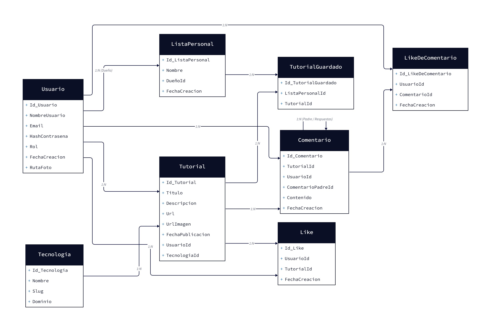
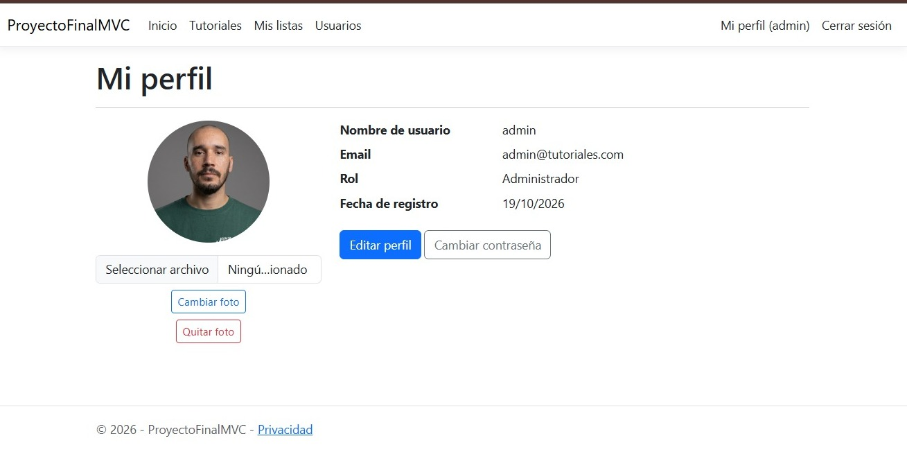

# TutorialHub – Plataforma de Tutoriales

## Descripción

Aplicación web desarrollada para **centralizar y facilitar el acceso a tutoriales de programación y tecnología**. El sistema permite publicar, consultar y organizar contenido educativo, facilitando el aprendizaje y la interacción entre usuarios.

El proyecto fue desarrollado utilizando **ASP.NET Core MVC, C#, Entity Framework Core y SQL Server**.

## Funcionalidades principales

- Gestión de usuarios y perfiles.
- Registro e inicio de sesión.
- Administración de roles (Usuario y Administrador).
- Publicación y consulta de tutoriales.
- Organización de tutoriales por tecnologías.
- Búsqueda y filtrado de tutoriales.
- Comentarios y respuestas.
- Sistema de likes en tutoriales y comentarios.
- Creación de listas personales.
- Guardado de tutoriales.
- Gestión de imágenes de perfil y miniaturas de YouTube.

## Acceso al sistema

El sistema cuenta con autenticación mediante cookies y contraseñas protegidas mediante **BCrypt**.

Los usuarios pueden registrarse e iniciar sesión para acceder a las funcionalidades correspondientes a su rol.

## Base de datos

La aplicación utiliza **SQL Server** y **Entity Framework Core** para la gestión de datos.

La estructura de la base de datos se administra mediante migraciones de Entity Framework Core.

## Tecnologías

- C#
- ASP.NET Core MVC
- Entity Framework Core
- SQL Server
- HTML
- CSS
- JavaScript
- Vue.js

## Requisitos mínimos y evidencias

Esta sección presenta el cumplimiento de los requerimientos solicitados, junto con referencias al código fuente y evidencias visuales del funcionamiento de la aplicación.

### 1. Cuatro tablas y relación 1:N

### 2. Login, roles y avatar

### 3. Manejo de archivos (extra)

### 4. ABM en Vue.js + AJAX

### 5. Paginado por servidor

### 6. Selección asíncrona (AJAX)

### 7. Web API + JWT

## Integrantes

- Moisés Elías Salas
- Kevin Roy Orozco
